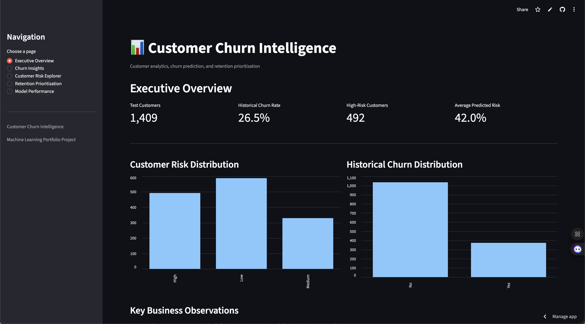
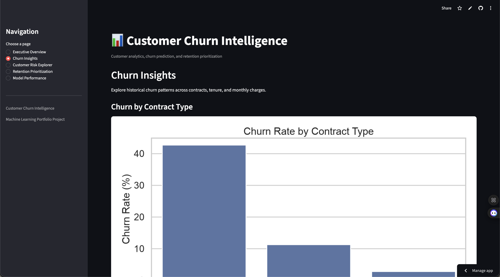
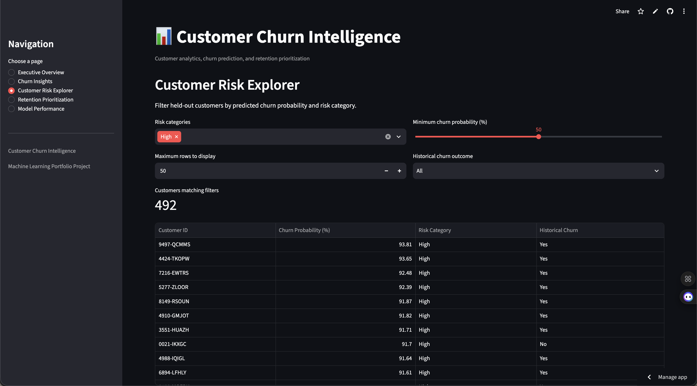
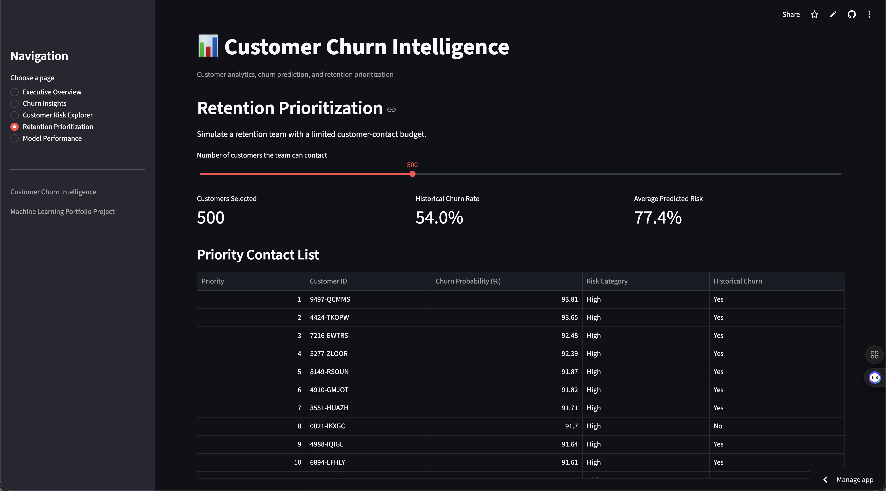
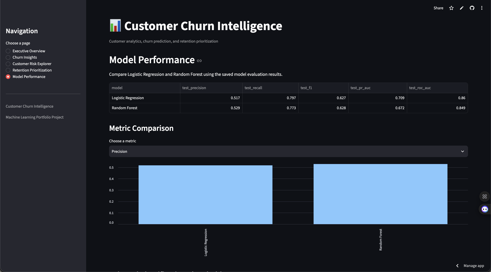

# Customer Churn Intelligence

An end-to-end machine learning project that analyzes customer churn, predicts churn risk, and prioritizes customers for retention analysis through an interactive Streamlit dashboard.

## Project Overview

Customer churn occurs when customers stop using a company's services. Identifying customers who may churn can help businesses investigate retention opportunities and allocate customer-success resources more effectively.

This project uses the IBM Telco Customer Churn dataset to explore historical churn patterns, train classification models, generate customer risk scores, and simulate a retention-prioritization workflow.

## Key Features

- **Exploratory Data Analysis:** Examine churn distribution, contract types, customer tenure, and monthly charges.
- **Data Preprocessing:** Handle missing values, scale numerical features, and encode categorical variables.
- **Machine Learning:** Train and compare Logistic Regression and Random Forest classifiers.
- **Model Evaluation:** Measure precision, recall, F1-score, PR-AUC, and ROC-AUC.
- **Customer Risk Scoring:** Estimate churn probabilities and categorize customers as Low, Medium, or High risk.
- **Retention Prioritization:** Rank customers by predicted churn probability under a simulated contact budget.
- **Interactive Dashboard:** Explore historical churn insights, filter customer risk scores, compare model metrics, and export CSV files.

## Technology Stack

- Python
- pandas and NumPy
- scikit-learn
- Matplotlib and Seaborn
- Streamlit
- Git

## Dataset

The project uses the IBM Telco Customer Churn dataset, containing 7,043 customer records and 21 columns.

The dataset includes customer demographics, subscribed services, contract information, tenure, billing details, and historical churn outcomes.

The original dataset is stored at:

`data/raw/telco_customer_churn.csv`

## Machine Learning Workflow

1. Load and inspect the dataset.
2. Convert `TotalCharges` to a numeric column and handle missing values through preprocessing.
3. Split the data into training and evaluation sets.
4. Impute missing values, scale numerical features, and one-hot encode categorical features.
5. Train Logistic Regression and Random Forest classifiers.
6. Evaluate model performance using classification metrics.
7. Generate churn probabilities for held-out customers.
8. Rank customers by predicted churn probability.
9. Present insights and model results through a Streamlit dashboard.

## Model Results

The initial model comparison produced the following results:

| Metric | Logistic Regression | Random Forest |
|---|---:|---:|
| Precision | 51.74% | 52.93% |
| Recall | 79.68% | 77.27% |
| F1-score | 62.74% | 62.83% |
| PR-AUC | 70.90% | 67.21% |
| ROC-AUC | 86.04% | 84.88% |

These figures are from the initial model-comparison report. A later scoring run used a different train/test split and reported Logistic Regression precision of 50.85%, recall of 80.21%, PR-AUC of 65.17%, and ROC-AUC of 84.00%.

Results can vary between data splits. The evaluation reports should be consulted for the corresponding experiment.

## Project Structure

```text
customer-churn-intelligence/
├── app.py
├── requirements.txt
├── README.md
├── .gitignore
├── data/
│   ├── raw/
│   │   └── telco_customer_churn.csv
│   └── processed/
├── models/
├── notebooks/
├── reports/
│   ├── figures/
│   ├── customer_churn_scores.csv
│   ├── eda_summary.txt
│   ├── model_comparison.csv
│   ├── model_evaluation.txt
│   ├── retention_priority_500.csv
│   └── scoring_evaluation.txt
└── src/
    ├── explore.py
    ├── visualize.py
    ├── train.py
    ├── score_customers.py
    └── retention_analysis.py
```

## Installation

### 1. Clone the repository

```bash
git clone YOUR_GITHUB_REPOSITORY_URL
cd customer-churn-intelligence
```

Replace `YOUR_GITHUB_REPOSITORY_URL` with your actual repository URL after publishing it.

### 2. Create a virtual environment

```bash
python3 -m venv .venv
```

Activate it on macOS or Linux:

```bash
source .venv/bin/activate
```

### 3. Install dependencies

```bash
pip install -r requirements.txt
```

### 4. Launch the dashboard

```bash
streamlit run app.py
```

Open the local URL shown in the terminal, usually `http://localhost:8501`.

## Running the Scripts

Run these commands from the project root:

```bash
python src/explore.py
python src/visualize.py
python src/train.py
python src/score_customers.py
python src/retention_analysis.py
```

The scripts generate analysis reports, figures, model evaluation results, customer risk scores, and retention-priority outputs under `reports/`.


## Live Demo

**[Launch Customer Churn Intelligence](https://customer-churn-intelligence-kiem9sibaregiwqeaumw0m.streamlit.app)**

## Dashboard Screenshots

### 1. Executive Overview


### 2. Churn Insights


### 3. Customer Risk Explorer


### 4. Retention Prioritization


### 5. Model Performance



## Dashboard Pages

- **Executive Overview:** Customer counts, historical churn, and risk distribution.
- **Churn Insights:** Contract and tenure analysis, with supporting visualizations.
- **Customer Risk Explorer:** Interactive filters for risk categories and churn probabilities.
- **Retention Prioritization:** Simulate a contact budget and export ranked customers.
- **Model Performance:** Compare model metrics and inspect classification thresholds where available.

## Limitations

- This project uses historical data; predicted churn is not a guarantee of future behavior.
- Risk categories use illustrative probability bands.
- A customer who is predicted to churn may stay, and a customer predicted to stay may churn.
- Prioritizing high-risk customers does not establish that a retention intervention will prevent churn.
- The scoring evaluation and initial model-comparison report use different data splits and should not be treated as identical experiments.
- Before production use, the workflow should be extended with validation-based model and threshold selection, monitoring, and evaluation on genuinely future data.

## Future Improvements

- Build a repeatable training and scoring pipeline.
- Add a documented validation-based threshold-selection strategy.
- Improve the distinction between retrospective evaluation and scoring new customers.
- Add automated tests and data-quality checks.
- Track model performance over time.
- Investigate retention costs and intervention outcomes.

## Author

**Naveen Mekala**

Machine Learning | Data Science | Customer Analytics

---

*This project is an educational portfolio demonstration and is not a production churn-management system.*
